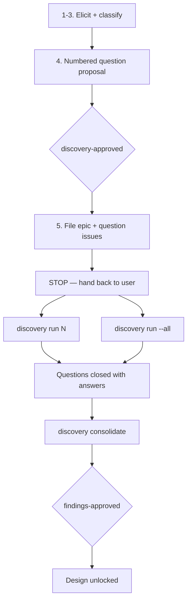

# Discovery

**Input:** a set of specs (a brief, a feature request, a refactor target, a pile of requirements).
**Output:** a Discovery epic with `type:research`/`type:spike` sub-issues, then — once they are answered — a versioned `docs/discovery/<topic>.md` findings doc.

Goal of the phase: turn fuzzy specs into resolved questions — clarify the technical work, and answer the important business questions — so Design starts from solid ground.

Discovery runs in **two operator-controlled stages with an execution step in between.** The skill never elicits questions and answers them in the same breath: filing the questions and working them are separate user-initiated actions, so the user decides when and how each question gets resolved.

| Verb | Does | Ends at |
|---|---|---|
| `/gh-sdlc discovery` | **Stage 1** — elicit, classify, propose, then file the epic + question issues | `discovery-approved`, then **STOP** (hand back) |
| `/gh-sdlc discovery run <N>` / `run --all` | **Execution** — resolve one question issue, or fan out across the unblocked ones | question issues closed with answers |
| `/gh-sdlc discovery consolidate` | **Stage 2** — lift the answers into the findings doc + PR | `findings-approved`, then Design unlocks |

Two tokens, two different things being gated (see [GATES.md](./GATES.md)):

- **`discovery-approved`** gates **issue creation** — the question set itself, before any `gh issue create`. Same shape as `plan-approved`.
- **`findings-approved`** gates **entry to Design** — the findings PR, after every question is answered.



---

# Stage 1 — Propose and file the questions

Invoked as `/gh-sdlc discovery`. **Produces issues, not answers.**

## 1. Elicit the open questions (delegate to `grilling`)

Call the Skill tool with `grilling` against the specs: interview the user relentlessly, one question at a time, walking the decision tree and resolving dependencies. **If a question can be answered by exploring the codebase, explore instead of asking.**

Capture every unresolved item as a candidate question. Do not start creating issues yet — first classify.

## 2. Classify each question: HITL vs AFK

Classify each candidate as HITL or AFK:

- **HITL — business question** (`type:research`): only a human can answer. Pricing rules, compliance constraints, which workflow the business actually wants, scope calls, "do we even need X". The agent **cannot** resolve these by reading code; it drafts the question and waits on the user.
- **AFK — tech spike** (`type:spike`): the agent can resolve it by investigating. Time-boxed code reading, dependency probes, "does the current `Order` model already expose Y", "how does the legacy god-class handle Z", spike a throwaway proof. Prefer AFK wherever possible.

Tag each candidate HITL or AFK before filing. The classification is load-bearing: it decides which questions `run --all` may fan out unattended and which get batched into a single interview.

## 3. Shape by greenfield vs refactor

- **Greenfield:** weight toward **business questions** and module sketching. Sketch the major modules you'll need and surface their unknowns as research issues. The dominant risk is "are we building the right thing".
- **Refactor:** weight toward **code-reading spikes**. The dominant risk is "what does the existing code actually do". File spikes that pin down current behavior of the god-classes/areas to be changed (e.g. `<path/to/legacy_module>:NN-MM` — what are the real inputs/outputs/edge cases), so Design isn't built on guesses.

## 4. Present the question set as a numbered proposal — hard-stop

Like [PLANNING.md](./PLANNING.md) step 1: present the whole question set as a **numbered proposal and iterate to approval before creating anything.** For each candidate show: number, proposed title, `type:research` (HITL) or `type:spike` (AFK), blocked-by edges, and a one-line statement of what decision it unblocks.

Also state the proposed **epic title** and the `docs/discovery/<topic>.md` slug the eventual findings will land under.

Iterate with the user on wording, splits, classification, and dependency edges. Then run the gate in [GATES.md](./GATES.md) and require the literal **`discovery-approved`** token.

**No `gh issue create` before `discovery-approved`.** This is the same irreversible-ish action Planning gates, so it gets the same treatment.

## 5. File the epic + questions, then STOP

Only after `discovery-approved`:

1. Create one **Discovery epic** (`type:epic`, `phase:discovery`) whose body states the spec under investigation, the key risks, and an auto-rendered sub-issue checklist.
2. Create each question as a sub-issue under it (see [SUBSTRATE.md](./SUBSTRATE.md) for `gh sub-issue` mechanics). **One resolvable question per issue** (the atomicity directive — see [SKILL.md](./SKILL.md)): if a candidate bundles several questions, split it so each can be answered, closed, and referenced on its own.
   - HITL → `type:research`; AFK → `type:spike`.
   - Wire `addBlockedBy` where one question can't be answered until another resolves.
3. Add every issue to the project board with **Status → Todo**, on the `Discovery` view (see [SUBSTRATE.md](./SUBSTRATE.md#project-views)).
4. **STOP.** Do not resolve anything. Do not open a findings doc. Hand back to the user with the run menu:

```
Discovery epic #<E> filed with <n> questions (<a> AFK spikes, <h> HITL questions).
Board: <project URL, Discovery view>

Nothing has been investigated yet — you choose how to work them:
  /gh-sdlc discovery run <N>     one question at a time
  /gh-sdlc discovery run --all   fan out the unblocked AFK spikes, batch the HITL ones
  /gh-sdlc discovery consolidate once every question is closed

Unblocked and ready now: #<N>, #<N>, ...
Blocked: #<N> (by #<N>) ...
```

### Question issue body

```markdown
## Question
<the specific thing we need to resolve, in one or two sentences>

## Why it matters
<what downstream Design/Planning decision is blocked on this>

## Kind
HITL (business) | AFK (spike)

## How to resolve
<for spikes: where to look / what to probe. for business questions: who decides.>

## Answer
<!-- filled in by `discovery run`; this text is lifted verbatim into the findings doc -->
```

The `## Answer` section is the contract between the execution step and Stage 2 — always leave it in the filed body as an empty placeholder so `consolidate` has a known slot to read.

---

# Execution — `discovery run`

Invoked as `/gh-sdlc discovery run <N>` (one issue) or `/gh-sdlc discovery run --all` (fan-out). This is the Discovery analogue of handing a task to the implementation loop: the user decides when it happens and at what parallelism.

## Per-issue housekeeping (mirrors the implementation loop's pre-flight)

1. Confirm the issue is `type:research`/`type:spike` under an open Discovery epic, and that `issue_dependencies_summary.blocked_by == 0`. If it is blocked, name the blockers and stop.
2. Assign it (`gh issue edit <N> --add-assignee @me`).
3. Set **Status → In Progress**.
4. Cascade the parent epic to **In Progress** if it is still Todo.

No branch and no PR: a question issue produces knowledge, not code. The branch/PR only appears in Stage 2 for the findings doc.

## AFK spike (`type:spike`)

1. Investigate: read the code, probe dependencies, check upstream docs, time-box it.
2. If a throwaway proof is needed, **run it in a temp dir (`mktemp -d`), never inside the repo tree.** A spike must leave zero footprint on the working copy — no stray scripts, no `package.json` churn, no committed experiments. Delete the temp dir when done.
3. Write the resolution into the issue body's **`## Answer`** section (`gh issue edit <N> --body-file`) — not just a comment, because `consolidate` reads the body. Include the evidence: file:line refs, command output, version numbers, the URL you verified against.
4. Add a one-line closing comment pointing at the answer, close the issue, set **Status → Done**.
5. If the spike disproves the question's premise or uncovers a new question, say so in the `## Answer` and propose the follow-up issue to the user — do not silently file it (that would re-enter Stage 1 without a gate).

## HITL research (`type:research`)

1. Do the homework first: gather whatever context makes the question cheap for the human to answer (options, trade-offs, what the code already constrains). Never ask a question the repo can answer.
2. Put the question to the user via `AskQuestion` with concrete options plus an escape hatch.
3. Record their answer verbatim-in-substance in **`## Answer`**, attributing it as a human decision, then close and set **Status → Done**.
4. Never invent a HITL answer. If the user defers, leave the issue open, note the deferral, and report it as a blocker for `consolidate`.

## `run --all` — fan-out rules

- **Only AFK spikes fan out.** Dispatch background subagents across the unblocked `type:spike` issues, one subagent per issue, each following the AFK procedure above.
- **All HITL questions are batched into one `grilling` interview** — never N separate prompts at the user. Collect them, interview once, then write each answer back to its own issue.
- **Respect the dependency graph.** Only `blocked_by == 0` issues are eligible. After a wave closes, re-evaluate: newly unblocked spikes become eligible for the next wave.
- Each subagent owns exactly one issue: its own housekeeping, its own temp dir, its own `## Answer` write-back and close. Report a summary table (issue, verdict, evidence) when the wave finishes.
- If a subagent's finding contradicts another's, surface the conflict to the user rather than picking a winner.

---

# Stage 2 — Consolidate the findings

Invoked as `/gh-sdlc discovery consolidate`.

**Preconditions** — verify before writing anything, and stop with a list if unmet:

- Every question sub-issue under the Discovery epic is **closed**.
- Every closed issue has a non-empty **`## Answer`** in its body.

## 1. Write the findings doc

Lift each `## Answer` into `docs/discovery/<topic>.md` — the durable, reviewable artifact — as a coherent narrative rather than a transcript dump. Suggested shape:

```markdown
# Discovery — <topic>

## Specs under investigation
<what we were handed>

## Resolved questions
### <Question> — <answer>
<the resolution, with #issue backlinks>

## Open risks carried into Design
<anything still uncertain but accepted>

## Implications for Design
<the constraints/decisions Design must honor>
```

Keep it findings-only — **no solution design yet.** That's the next phase. Every claim traces back to a closed issue; if something in the doc has no issue behind it, either cut it or file the question.

## 2. Reach the hard-stop

1. Commit the doc (single-line commit) on branch `em/<epic#>_discovery_<slug>` and open the PR.
2. Run the **Discovery findings gate** in [GATES.md](./GATES.md): present the findings and require the literal **`findings-approved`** token.
3. On approval: merge the PR, close the Discovery epic, set its Status → Done.

**Design is unlocked only after that merge.** The merged PR + the closed question issues are the durable record Design builds on.
